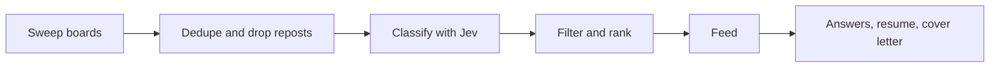

<div align="center">

# SWE Radar

**Fresh software engineering jobs, filtered by meaning, on your Mac.**

SWE Radar sweeps job boards for software engineering postings from the last few hours, has an AI read each one against your regions, experience, work authorization and language limits, and ranks what is left. Then it drafts your application answers and a tailored resume and cover letter with the AI CLI you already pay for. It runs locally. There is no server and no account.

[](LICENSE)
[](#install)
[](https://www.electronjs.org)
[](https://bun.sh)

</div>

---

## The problem

The best time to apply is the first few hours after a job goes up. Job sites bury those postings under reposts, senior roles, wrong countries and "remote, US only". Their filters match keywords, so "remote" means nothing and "junior" misses half the junior roles.

SWE Radar asks a model the questions you would ask yourself: can I take this job from where I live, am I allowed to work there, how many years does it really want, does it require a language I do not speak.

## How it works



1. **Sweep.** LinkedIn guest search, Amazon, Microsoft, and the Greenhouse, Lever, Ashby, SmartRecruiters and Recruitee boards listed in [`data/boards.json`](data/boards.json), limited to your time window.
2. **Dedupe.** The same job on several boards shows once. Reposts of an older listing are marked, not shown as new.
3. **Classify.** [TypeSafe Jev](https://typesafe.ai) reads each posting and answers structured questions: is it hands-on engineering in your role scope, does it fit each of your regions, what seniority and how many years it requires, whether your work authorization is enough, whether it requires a language you excluded, what it pays, how stable the employer is.
4. **Rank.** Mechanical filters drop what you excluded. What is left is ordered by employer stability and pay against your floor. Glassdoor ratings are looked up through your AI CLI and shown on each card.
5. **Apply.** Paste an application question and get an answer written from your profile. Generate a resume and cover letter tailored to the posting and checked against ATS rules, as PDFs.

Optional extras:

- **LinkedIn login.** Sign in once inside the app and it confirms whether a LinkedIn posting is fresh or a repost.
- **Proxies.** A `proxies.txt` in the app data folder (or `SWE_RADAR_PROXIES`) spreads board requests over http, https or socks5 proxies.
- **Background schedule.** Installed to `/Applications`, the app registers a launchd agent and sweeps on its own from the tray.

## Setup

On first launch the setup screen opens. In order:

1. **Regions.** Add up to 8. Each has a label and a plain description, for example "anywhere in Germany, or remote within the EU". Jev judges each posting against that description, so write it the way you would explain it to a person.
2. **Work country.** Where you are authorized to work. Optionally, a country to skip when a job hires only there.
3. **Experience.** Max years required, and the seniority levels to skip.
4. **Languages.** Required languages that rule a job out.
5. **Pay.** Currency and a floor. Leave it at 0 to ignore pay. Posted pay is converted into your selected currency for ranking using daily ECB reference rates from [Frankfurter](https://frankfurter.dev/). Cards keep the original posted amount and currency. Rates are cached for 24 hours in `exchange-rates.json` beside the app store; if no fresh rates are available or a currency is unsupported, Jev estimates pay as before.
6. **AI provider.** Codex or Claude Code, for answers and documents.
7. **TypeSafe key.** Paste your API key in Options. It is encrypted with the macOS keychain. `TYPESAFE_API_KEY` works as a fallback.
8. **Profile and resume.** Write your profile in the app; it is what answers are written from. Put your resume and cover letter template in [`data/resume.ts`](data/resume.ts) and [`data/cover-letter.ts`](data/cover-letter.ts), which ship with an example.

Then refresh.

## Install

There is no packaged release yet. Build from source.

Prerequisites:

- macOS
- [Bun](https://bun.sh) 1.3 or later
- [Codex CLI](https://github.com/openai/codex) or [Claude Code](https://docs.anthropic.com/en/docs/claude-code), installed and signed in (run `codex` or `claude` once)
- A [TypeSafe](https://typesafe.ai) API key

```bash
bun install
bun run dev          # run from source with hot reload
bun run install-app  # build, package and copy SWE Radar into /Applications
```

The background schedule only runs from the installed app in `/Applications`.

## Choosing Codex or Claude

Both work. Pick the one you already have a subscription for, because every answer, document and company rating lookup runs through it.

The app calls the CLI headless, in a throwaway folder, with your own config ignored, no shell and no file tools. Company rating lookups are the only calls with web search on. You can switch at any time in settings.

## Privacy

Your settings, profile, saved snippets, the job store and the encrypted key stay in `~/Library/Application Support/SWE Radar`. There is no telemetry.

What leaves your machine:

- **Job board requests** to LinkedIn, Amazon, Microsoft and the boards in `data/boards.json`, through your proxies if you set them.
- **Jev classification calls** to TypeSafe: the posting text plus your region descriptions, work country and limits.
- **Your chosen AI CLI**, which sends the posting, your profile and resume data, and your question to OpenAI or Anthropic under your own account.
- **LinkedIn**, if you sign in, to check postings with your session.

## Status

Early, and deliberately small.

**In:** the board sweep, Jev classification into your own regions and limits, repost detection, ranking, application answers, tailored resume and cover letter PDFs with an ATS check, the LinkedIn repost check, proxies, and the background schedule.

**Out, on purpose:** no Windows or Linux build, no packaged release, no resume editor in the app, no cloud sync, no accounts, no auto apply. They are tracked as issues.

## Contributing

Issues and pull requests are welcome. See [CONTRIBUTING.md](CONTRIBUTING.md). Security reports go through [SECURITY.md](SECURITY.md).

## License

AGPL-3.0-only, copyright Abhiram Shaji. Contributions under the [CLA](CLA.md). Commercial licensing: open an issue or contact via GitHub. See [docs/LICENSING.md](docs/LICENSING.md).
